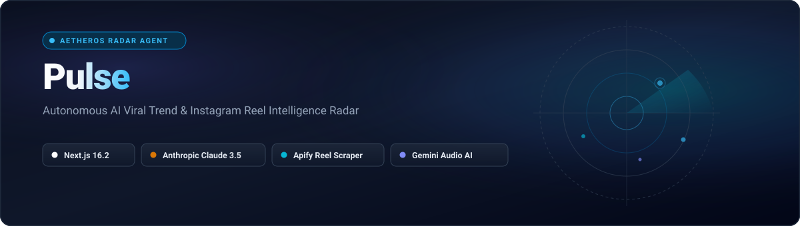
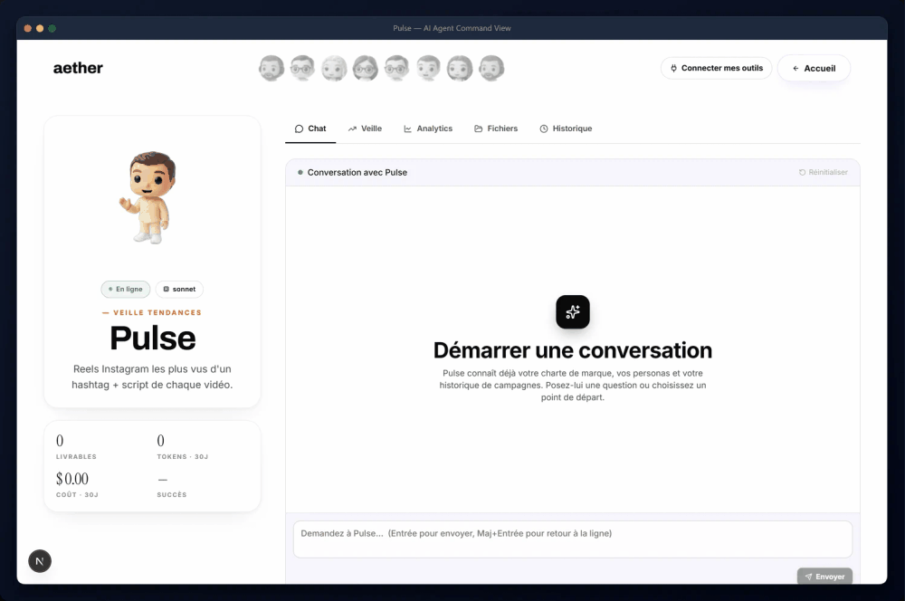
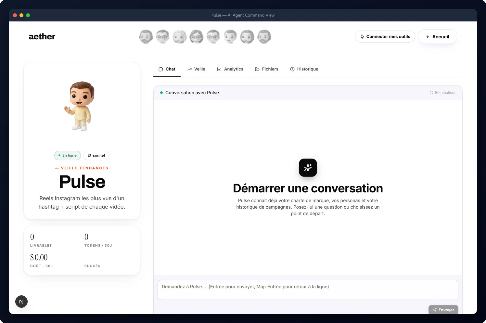
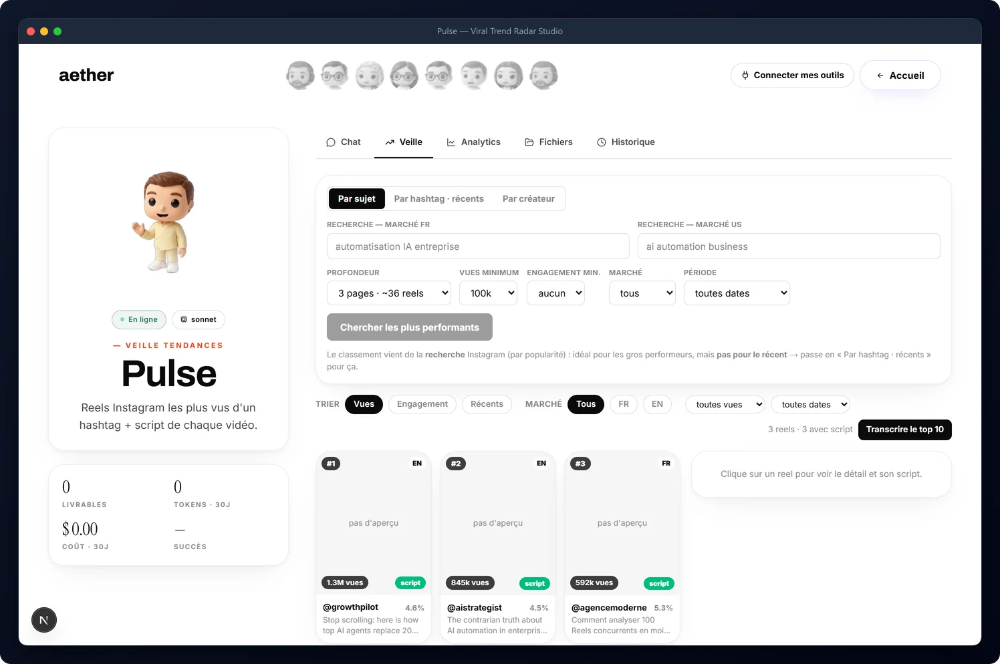
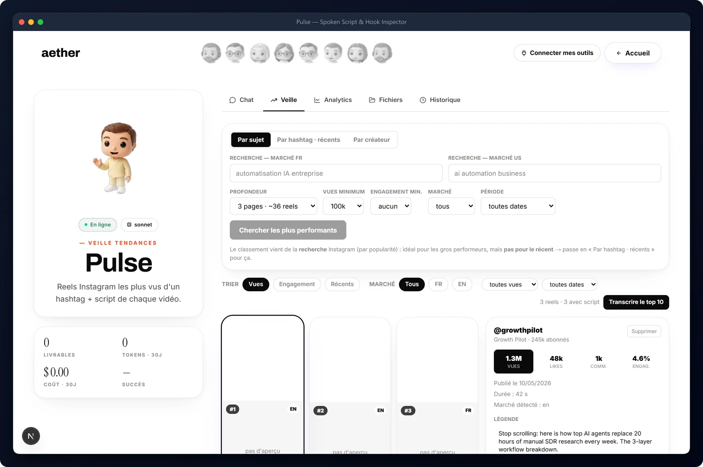
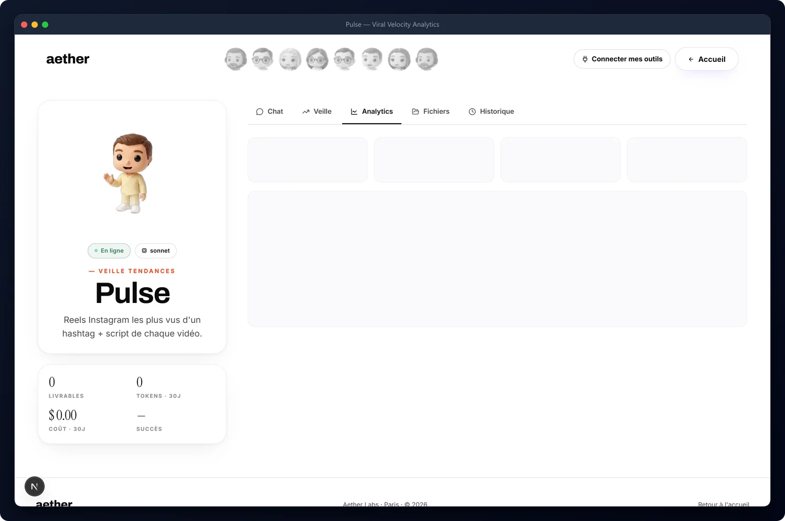
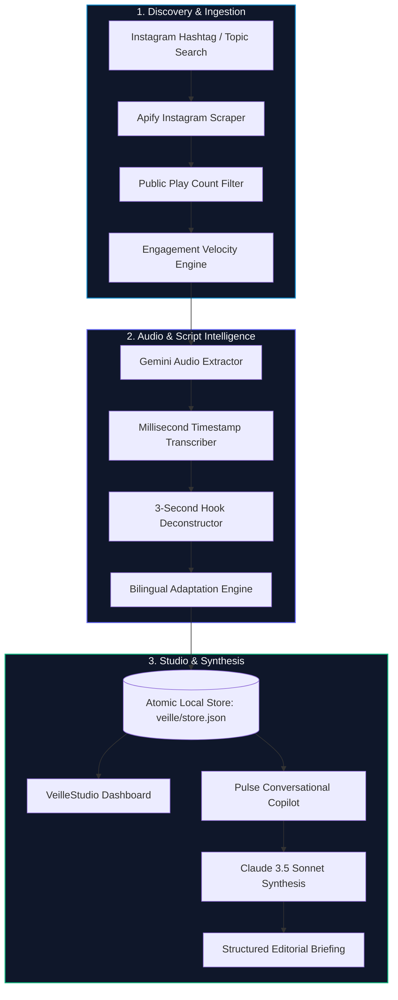

<div align="center">



# Pulse — AI Viral Trend & Reel Intelligence Radar

[](https://nextjs.org/)
[](https://react.dev/)
[](https://www.typescriptlang.org/)
[](https://console.anthropic.com/)
[](https://github.com/)
[](LICENSE)

<p align="center">
  <a href="#live-demo"><b>Live Demo</b></a> •
  <a href="#screenshots"><b>Screenshots</b></a> •
  <a href="#key-capabilities--specialized-studio-ui"><b>Capabilities</b></a> •
  <a href="#architecture"><b>Architecture</b></a> •
  <a href="#how-to-install--configure"><b>Installation</b></a> •
  <a href="#how-to-use"><b>How to Use</b></a>
</p>

</div>

---

**Pulse** is an autonomous AI viral trend intelligence radar built on the **AetherOS** multi-agent architecture. Designed for social media strategists, viral creators, and marketing teams, Pulse scrapes and benchmarks top-performing Instagram Reels across target hashtags, transcribes spoken video scripts using Google Gemini, extracts repeatable hook formulas, and produces actionable viral intelligence briefings powered by Anthropic Claude.

---

## Live Demo



---

## Screenshots

<table>
  <tr>
    <td width="50%" align="center">
      <br />
      <b>Unified Agent Command View</b><br />
      <sub>Conversational intelligence studio guiding trend queries and ICP editorial strategies</sub>
    </td>
    <td width="50%" align="center">
      <br />
      <b>Instagram Viral Trend Radar (VeilleStudio)</b><br />
      <sub>Autonomous discovery ranking Reels strictly by verified public play velocity</sub>
    </td>
  </tr>
  <tr>
    <td width="50%" align="center">
      <br />
      <b>Spoken Script &amp; Hook Inspector</b><br />
      <sub>Millisecond-accurate transcript breakdown, hook formulas, and bilingual adaptations</sub>
    </td>
    <td width="50%" align="center">
      <br />
      <b>Viral Velocity Analytics</b><br />
      <sub>Multi-market benchmarking across French, US, and international creator ecosystems</sub>
    </td>
  </tr>
</table>

---

## Key Capabilities & Specialized Studio UI

### 1. Instagram Viral Radar (`VeilleStudio`)
Pulse connects to Apify's Instagram scraper (`apify/instagram-hashtag-scraper`) to monitor any niche hashtag:
- **Verified Play Count Ranking**: Instagram systematically masks like counters on hashtag endpoints (returning `0` or `-1`). Pulse ignores obscured like counts and ranks videos strictly by verified public views (`videoPlayCount`) and calculated engagement velocity.
- **Top Reel Discovery**: Surfaces high-velocity viral Reels, account follower ratios, comments, and share metrics across French, English, and international markets.
- **Zero Hallucination Data**: Only verified API metrics are surfaced; if a metric is unavailable or masked by the platform, Pulse explicitly marks it rather than estimating.

### 2. Audio Script Transcription & Gemini Pipeline
- **Spoken Script Extraction**: Sends Reels directly to Google Gemini to transcribe audio tracks into complete spoken scripts with millisecond timestamps (`[0:00]`, `[0:03]`).
- **Hook & Structure Analysis**: Isolates the first 3 seconds of spoken and visual hooks, pacing transitions, and call-to-action triggers.
- **Multilingual Translation**: Automatically provides bilingual outputs (original transcript + French/English adaptation) ready for immediate content repurposing.

### 3. Trend Intelligence Briefings
- **Viral Angle Synthesis**: Groups analyzed Reels by angle, emotional trigger (curiosity, controversy, education, contrarian), and storytelling frameworks (Hook-Story-Offer, BAB).
- **Creator Handoff**: Synthesizes structured markdown briefings that feed directly into copywriting engines.
- **Atomic Local Persistence**: Stores scraped posts and transcribed scripts safely in `veille/store.json` using atomic write locks.

---

## Architecture

### System Flowchart



### Directory Structure

```
pulse-trend-radar/
├── .claude/
│   └── agents/
│       └── veille.md             # Pulse system prompt, ranking rules, & analysis guidelines
├── aether-studio/                # Next.js 16 full-stack Studio application
│   ├── src/
│   │   ├── app/                  # App Router & API routes (/api/chat, /api/veille/*)
│   │   ├── components/           # UI: VeilleStudio, AgentTabs, AgentChat
│   │   └── lib/                  # Central registry, Apify client, Gemini pipeline, paths
│   ├── .env.example              # Environment blueprint with template lock & Apify setup
│   └── package.json              # Studio dependencies (Next 16, React 19, Tailwind CSS 4)
├── clients/
│   └── votre-marque/
│       └── brand.md              # Brand guide: target niche, topics, and ICP definitions
├── docs/
│   └── screenshots/              # Framed WebP captures and demo assets
│       ├── demo.gif              # Real interactive studio recording
│       ├── hero-banner.svg       # Clean dark-slate presentation vector banner
│       ├── pulse-agent-view.webp # Unified agent command view
│       ├── pulse-analytics-view.webp # Engagement velocity analytics
│       ├── pulse-radar-view.webp # Instagram viral trend radar
│       └── pulse-script-inspector.webp # Spoken script & hook inspector
├── veille/                       # Local JSON store & trend deliverable directory
│   └── store.json                # Persisted viral Reels, transcripts, and metrics
├── CLAUDE.md                     # Zero-friction onboarding instructions for Claude Code
└── README.md                     # Product documentation & technical specifications
```

---

## How to Install & Configure

Follow these steps to set up and run Pulse locally:

### 1. Prerequisites
- **Node.js**: v20.x or higher (`node -v`)
- **npm**: v10.x or higher (`npm -v`)
- **Anthropic API Key**: Obtain from [Anthropic Console](https://console.anthropic.com/settings/keys)
- **Apify API Token**: (Optional for live scraping) Obtain from [Apify Console](https://console.apify.com/account/integrations)
- **Google Gemini API Key**: (Optional for video audio transcription) Obtain from [Google AI Studio](https://aistudio.google.com/app/apikey)

### 2. Clone Repository & Install Dependencies
```bash
git clone https://github.com/Emincanozen/pulse-trend-radar.git
cd pulse-trend-radar/aether-studio
npm install --no-audit --no-fund
```

### 3. Environment Configuration
Copy `.env.example` into `.env.local`:
```bash
cp .env.example .env.local
```

Configure your secrets in `.env.local`:
```env
# Anthropic Claude API Key (Required for conversational intelligence)
ANTHROPIC_API_KEY="sk-ant-api..."

# Standalone Template Lock (Preset to veille)
OWNED_AGENT=veille
NEXT_PUBLIC_OWNED_AGENT=veille

# Apify Token (Required for live Instagram scraping)
APIFY_TOKEN="apify_api_..."

# Google Gemini API Key (Optional: enables audio video transcription)
GEMINI_API_KEY="AIzaSy..."
```

### 4. Launch the Development Server
```bash
npm run dev
```

Navigate to `http://localhost:3000` (or `http://localhost:3204` if running with custom port `-p 3204`). The application will redirect straight to `/agents/veille`.

---

## How to Use

### 1. Discover Viral Reels in Your Niche
1. Click on the **Veille** tab in the studio navigation bar.
2. Choose your search mode:
   - **By Subject (`Par sujet`)**: Enter target keywords in French (e.g. `automatisation IA entreprise`) or English (e.g. `ai automation business`).
   - **By Hashtag (`Par hashtag`)**: Monitor specific industry tags (e.g. `#b2b`, `#growthhacking`).
   - **By Creator (`Par créateur`)**: Track leading competitors and viral influencers.
3. Configure minimum thresholds (e.g., minimum 100k views, depth of 3 pages).
4. Click **Search Top Performers (`Chercher les plus performants`)**.

### 2. Inspect Transcripts & Deconstruct Viral Hooks
1. Browse the resulting cards ranked strictly by public view count (`videoPlayCount`).
2. Click on any video card to open the **Inspector Panel**.
3. Review the complete spoken transcript with millisecond markers, identify the first 3 seconds of spoken hook, and review the French adaptation.
4. Use **Transcribe Top 10 (`Transcrire le top 10`)** for bulk processing.

### 3. Generate Editorial Briefs via Claude
1. Switch to the **Chat** tab.
2. Ask Pulse to synthesize an editorial brief:
   ```text
   "Analyze the top 3 videos currently in our radar and extract 5 hook structures we can adapt for our brand."
   ```
3. Pulse parses the store, combines it with your brand guidelines (`clients/votre-marque/brand.md`), and outputs ready-to-record video scripts.

---

## How to Create & Customize Agents

The AetherOS architecture makes it straightforward to tailor Pulse or scaffold new autonomous agents:

### 1. Customizing Brand Guidelines
Edit `clients/votre-marque/brand.md` to define your company's editorial posture:
```markdown
# Brand Context — Votre Marque
- **Industry Vertical**: B2B AI Automation & SaaS
- **Target Audience (ICP)**: Agency Founders, CMOs, Growth Leads
- **Content Angles**: Contrarian automation takes, ROI breakdowns, step-by-step agent workflows
- **Forbidden Topics**: Unverified claims, get-rich-quick framing, black-hat scraping
```

### 2. Modifying Agent Personality & Rules
Pulse's system prompt lives in `.claude/agents/veille.md`. You can fine-tune:
- Ranking algorithms (e.g., prioritize shares over comments).
- Hook classification frameworks (e.g., Hook-Story-Offer, BAB, PAS).
- Output language settings and synthesis constraints.

### 3. Adding New Specialized Agents
To add another agent to your AetherOS suite:
1. Create a specification file in `.claude/agents/<slug>.md`.
2. Register the slug in `aether-studio/src/lib/agents.ts` with its name, icon, and role.
3. Add custom studio components or pipeline panels under `aether-studio/src/components/`.
4. Define atomic data storage in `{repo}/<slug>/store.json`.

---

## Environment Variables Reference

| Variable | Required | Default | Description |
| :--- | :---: | :---: | :--- |
| `ANTHROPIC_API_KEY` | **Yes** | — | Anthropic Claude API Key powering chat and trend synthesis. |
| `OWNED_AGENT` | **Yes** | `veille` | Standalone template lock enforcing Pulse as the active agent. |
| `NEXT_PUBLIC_OWNED_AGENT` | **Yes** | `veille` | Client-side agent lock for the Next.js frontend studio view. |
| `APIFY_TOKEN` | **Yes** (live scrape) | — | Apify API token for Instagram hashtag and Reel scraping. |
| `GEMINI_API_KEY` | Optional | — | Google Gemini API Key for audio / video script transcription. |
| `ANTHROPIC_MODEL_SONNET` | Optional | `claude-sonnet-4-20250514` | Custom Claude Sonnet model identifier override. |
| `ANTHROPIC_MODEL_OPUS` | Optional | `claude-opus-4-20250514` | Custom Claude Opus model identifier override. |
| `NEXT_PUBLIC_UNLOCK_URL` | Optional | — | Redirect URL for upgrade prompts or multi-agent suite access. |

---

## License & Credits

Built with [AetherOS Architecture](https://github.com/) & [Next.js 16](https://nextjs.org/). Powered by Anthropic Claude, Apify, and Google Gemini.
Released under the MIT License.
